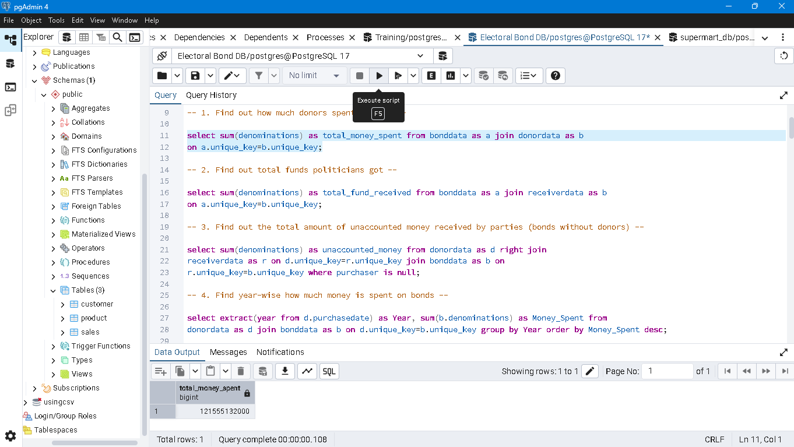
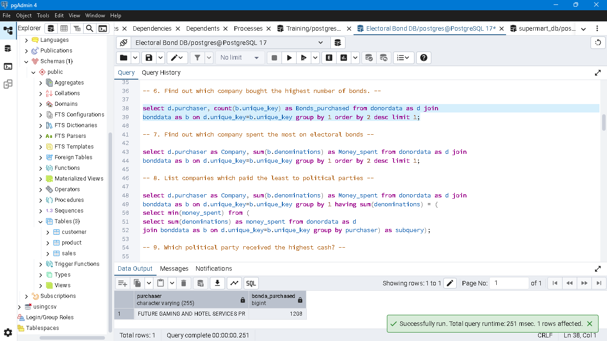
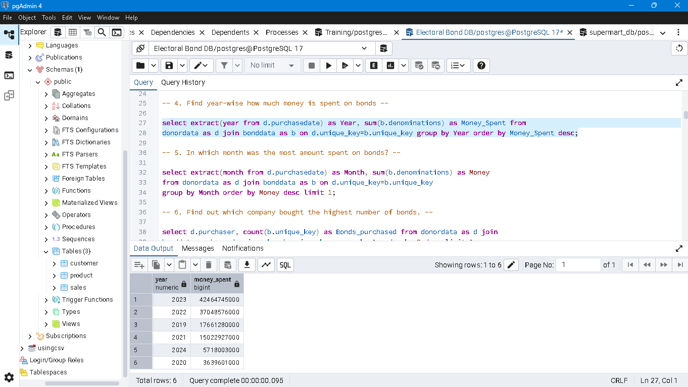
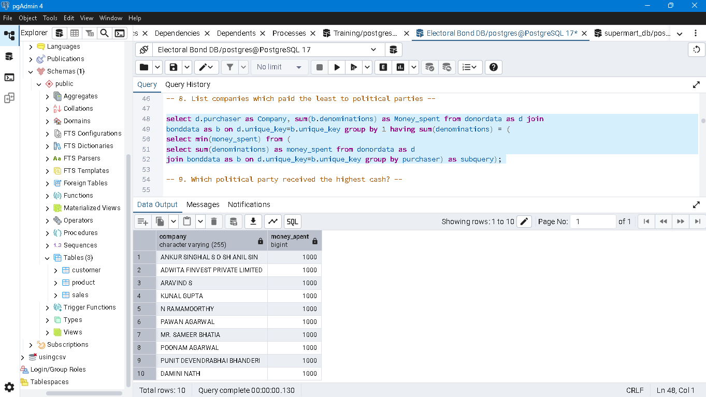

# Electoral Bond Analysis Using PostgreSQL

## 📌 Project Overview

This project focuses on analyzing Electoral Bond data using PostgreSQL and SQL queries. The objective is to explore donor contributions, political party funding, company spending, year-wise trends, city-wise transactions, and employee performance related to the issuance and encashment of electoral bonds.

The project uses multiple tables and SQL joins to connect the data and answer business-style analytical questions through aggregation, filtering, sorting, subqueries, window functions, and views.

## 🎯 Project Objectives

- Calculate the total amount spent by donors on electoral bonds.
- Analyze the total funds received by political parties.
- Identify companies with the highest and lowest contributions.
- Examine year-wise and month-wise spending trends.
- Analyze electoral bond purchases and encashments across cities.
- Identify political parties receiving the highest and lowest amounts and numbers of bonds.
- Investigate bonds without associated donor records and donors whose bonds have no associated recipient record.
- Analyze employee performance based on the number and amount of bonds issued and encashed.

## Project Preview









## 🛠️ Tools and Technologies

- **Database:** PostgreSQL
- **Query Language:** SQL
- **Project Files:** SQL script and project question document
- **Analysis Techniques:** Data aggregation, joins, filtering, sorting, subqueries, Common Table Expressions (CTEs), window functions, and views

## 🗂️ Project Folder Structure

```text
Electoral_Bond_Project/
│
├── ElectoralBond_ProjectSQL.sql
│   └── SQL queries used to analyze electoral bond data
│
├── Questions on Electoral bonds.pdf
│   └── Original project questions and additional practice questions
│
├── README.md
│   └── Project overview, objectives, tools, and documentation
│
└── Screenshots
    └── image_1
    └── image_2
    └── image_3
    └── image_4
```

## 🗄️ Database Tables

The SQL script references four tables:

| Table Name | Purpose in the Analysis |
|---|---|
| `bankdata` | Bank branch information, including branch codes and cities |
| `bonddata` | Electoral bond records and denominations |
| `donordata` | Donor information, purchase dates, purchaser names, and issuing employee details |
| `receiverdata` | Recipient information, political party names, and encashment details |

The tables are joined using `unique_key` and branch codes to connect bond, donor, recipient, and bank information.

## 📊 Key Analysis Areas

### 1. Donor Contributions
- Calculate the total amount spent by donors.
- Identify the company purchasing the highest number of bonds.
- Find the company spending the highest amount.
- Identify companies contributing the least amount.
- Find the second-highest donor by total spending.

### 2. Political Party Funding
- Calculate the total funds received by political parties.
- Identify parties receiving the highest and lowest amounts.
- Find parties receiving the highest and lowest numbers of bonds.
- Identify the second-highest party by donation amount and bond count.

### 3. Time-Based Analysis
- Calculate year-wise spending on electoral bonds.
- Identify the month with the highest total spending.
- Compare spending across different years.

### 4. City-Wise Analysis
- Identify the city with the highest number of bonds purchased.
- Find the city with the highest total purchase amount.
- Identify cities with the lowest number of bonds purchased.
- Analyze cities with the highest and lowest numbers of bonds encashed.

### 5. Unmatched Donor and Recipient Records
- Calculate the amount associated with bonds received by parties without matching donor records.
- Count donors whose bonds have no matching recipient record.
- Calculate the amount associated with those unmatched recipient records, as explored in the SQL script.

### 6. Employee Performance Analysis
- Identify employees issuing the highest and lowest numbers of bonds.
- Find employees associated with the highest and lowest amounts of issued bonds.
- Analyze employees assisting with the highest and lowest numbers of encashed bonds.
- Identify employees associated with the highest and lowest encashed amounts.

The SQL script creates the views `employee_bond_info` and `receiver_bond_info` to support employee-level analysis.

## 💡 SQL Concepts Demonstrated

- `SELECT` statements
- `INNER JOIN`, `LEFT JOIN`, and `RIGHT JOIN`
- Aggregate functions: `SUM()`, `COUNT()`, and `MIN()`
- `GROUP BY` and `HAVING`
- `ORDER BY` and `LIMIT`
- Date extraction using `EXTRACT()`
- Subqueries
- Common Table Expressions (CTEs)
- Window functions, including `DENSE_RANK()`
- Views using `CREATE VIEW`
- Handling unmatched records using `NULL` checks

## ▶️ How to Run the Project

1. Install PostgreSQL and open a SQL client such as pgAdmin.
2. Create or select a database for the project.
3. Import or load the electoral bond dataset into the database.
4. Ensure the four tables exist with the expected names and compatible column structures:
   - `bankdata`
   - `bonddata`
   - `donordata`
   - `receiverdata`
5. Open `ElectoralBond_ProjectSQL.sql` in the SQL query editor.
6. Execute the queries and review the result sets.
7. Run the view-creation statements before executing queries that depend on those views.

**Important:** The SQL script contains queries that reference existing tables. The dataset and table-creation/import scripts are not included in this repository unless added separately.

## 📁 Repository Contents

- **ElectoralBond_ProjectSQL.sql:** Contains the SQL queries written for the project.
- **Questions on Electoral bonds.pdf:** Contains the original project questions and additional practice questions.
- **README.md:** Documents the project scope, folder structure, SQL concepts, and execution steps.
- **Screenshots:** Shows the images of the query that was written in PostgreSQL.

## 📌 Project Scope and Limitations

This repository documents the SQL analysis and the questions addressed by the available query script. The original question document also contains questions that may require additional queries.

The results depend on the completeness and accuracy of the underlying dataset, table relationships, and query logic. Findings should be interpreted within the scope of the available records.

## 👨‍💻 Author

**Rashid Kamal**

*This project was created as a hands-on exercise in SQL querying, relational data analysis and extracting insights from electoral bond data.*
